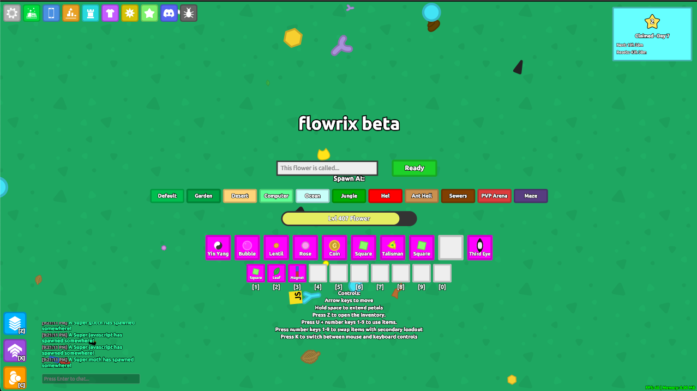

# flowrix 

[florr.io](https://florr.io) clone

[Public Server](https://florrclone.cryodome.com)

[Discord](https://discord.com/invite/SvAYCGsmAg)

**If the game is blocked at your school, try using
[https://florrclone.cryodome.com:3000](https://florrclone.cryodome.com:3000),
click advanced options and continue to site.**



> **License notice:** As of October 2026 this project is licensed under the
> [GNU Affero General Public License v3.0 or later](LICENSE) (previously GPL v3
> or later, and before that ISC), because it contains code adapted from gardn:
> [trigonal-bacon/gardn](https://github.com/trigonal-bacon/gardn)

[public server](https://florrclone.cryodome.com).

## Local server:

Run
```bash
npm run start_nobuild
```
to run from dist folder
open <http://localhost:3000>.

**Like the game? Star the GitHub repository!**

## License

Copyright (c) 2026 sussybite8888

This program is free software: you can redistribute it and/or modify it under
the terms of the GNU Affero General Public License as published by the Free
Software Foundation, either version 3 of the License, or (at your option) any
later version. See [LICENSE](LICENSE) for the full text.

This program is distributed in the hope that it will be useful, but WITHOUT
ANY WARRANTY; without even the implied warranty of MERCHANTABILITY or FITNESS
FOR A PARTICULAR PURPOSE. See the GNU Affero General Public License for more
details.
